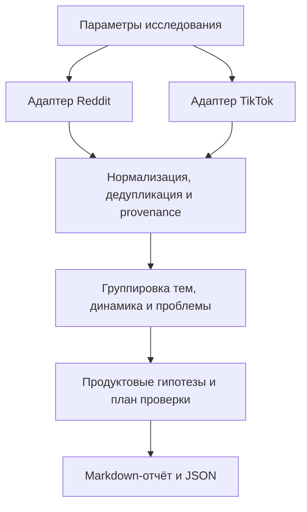

# NicheHunter

<p align="center">
  
</p>

**От наблюдений в Reddit и TikTok — к проверяемым идеям небольших цифровых продуктов.**

NicheHunter — проект исследовательского инструмента для поиска перспективных ниш до начала разработки. Он задуман как повторяемый workflow: собрать сигналы из выбранных источников, найти растущие темы и незакрытые потребности, сопоставить их с существующими решениями и предложить продуктовые гипотезы вместе со способом привлечения аудитории.

> **Статус на 29 октября 2026 года:** подготовка первой итерации. В репозитории находятся описание проекта, инструкции для работы и аватар. Сборщики данных, аналитика и команды запуска пока не реализованы. Ниже описано целевое поведение; README будет обновляться по мере реализации и проверки источников.

## Зачем нужен проект

Небольшое приложение можно быстро разработать, но до этого нужно ответить на несколько вопросов:

- У кого есть конкретная проблема и как часто она возникает?
- Какие решения люди уже используют и чем недовольны?
- Наблюдается устойчивый спрос или короткий всплеск внимания?
- Через какой канал можно донести продукт до этой аудитории?
- Есть ли признаки готовности платить и что ещё нужно проверить?
- Какой минимальный эксперимент стоит провести до полноценной разработки?

NicheHunter должен сократить путь от разрозненных обсуждений и трендов до небольшого набора обоснованных гипотез. Основной фокус — узкие цифровые продукты, которые можно быстро создать и протестировать: iOS-приложения, web-инструменты и небольшие сервисы.

## Основная идея: Distribution First

Выбор продукта начинается с аудитории и канала, через который до неё можно добраться:

```text
Канал и аудитория
  → наблюдаемая проблема или желание
  → проверка спроса и существующих решений
  → продуктовая и экономическая гипотеза
  → минимальный эксперимент
  → MVP и измерение реального поведения пользователей
```

Исследование учитывает две модели привлечения:

| Модель | Как появляется интерес к продукту | Что важно для гипотезы |
| --- | --- | --- |
| Существующий спрос | Человек уже ищет решение конкретной задачи | Формулировка проблемы, намерение решить её, используемые альтернативы |
| Discovery через контент | Человек замечает полезный или привлекательный результат в ленте | Наглядная демонстрация, понятная ценность, повод перейти к продукту |

Поэтому идея должна включать и сам продукт, и предполагаемый способ его дистрибуции. Например, для одной задачи подходящим экспериментом может оказаться поиск людей, которые уже спрашивают о решении, а для другой — короткая демонстрация результата в TikTok.

## Первая итерация: Reddit + TikTok

Целевой охват первой итерации — **оба источника**. Адаптеры будут подключаться поэтапно, после проверки фактического доступа к данным. Каждый источник должен работать отдельно; совместное исследование должно показывать совпадения, различия и пробелы в наблюдениях.

### Reddit: проблемы, обходные решения и неудовлетворённый спрос

Планируется собирать релевантные публикации и доступные комментарии по темам, запросам и выбранным сообществам. Для наблюдений нужны ссылки, идентификаторы, даты и доступные показатели активности.

Что искать:

- Повторяющиеся вопросы «как сделать», «есть ли приложение», «какая есть альтернатива».
- Ручные операции и неудобные обходные решения, которые люди повторяют регулярно.
- Жалобы на цену, сложность, качество или ограничения существующих продуктов.
- Описания конкретной аудитории, задачи и условий использования.
- Прямые высказывания о покупке или готовности платить, если такие свидетельства есть.

Результатом должны стать проверяемые формулировки проблем со ссылками на обсуждения. При анализе нужно учитывать повторы, рекламные публикации, особенности сообществ и размер выборки. Один популярный тред сам по себе не подтверждает устойчивый рыночный спрос.

### TikTok: темы, поисковые сигналы и продуктовые демонстрации

Планируется исследовать доступные темы и контент: поисковые рекомендации, тематические группы, хештеги, видео, демонстрации продуктов и комментарии. Конкретный набор данных будет зависеть от проверенного источника, региона и разрешений.

Что искать:

- Повторяющиеся демонстрации полезного результата: «до/после», автоматизация, быстрое решение задачи.
- Вопросы зрителей о том, каким инструментом получен результат и как его повторить.
- Темы, которые сохраняют интерес у разных авторов и в нескольких временных срезах.
- Поисковые потребности и недостаток подходящего контента там, где источник действительно предоставляет такие данные.
- Креативные подходы, которые можно использовать в небольшом тесте продуктовой гипотезы.

Поисковые запросы, рекомендованные keywords, тематические группы, хештеги и просмотры будут учитываться как разные типы сигналов. Сведения о буквальной поисковой фразе нельзя автоматически заменять названием темы, а просмотры роликов — числом поисков.

Варианты доступа к данным TikTok, включая Business Discovery, Creator Search Insights, Creative Center и сторонних поставщиков, предстоит проверить до выбора интеграции. Наличие интерфейса с трендами не гарантирует доступного API или исторических поисковых объёмов. Если доступны только контентные сигналы, отчёт должен прямо это указывать.

### Совместный анализ

Reddit и TikTok должны дополнять друг друга. Например, обсуждения могут раскрыть повторяющуюся ручную задачу, а видео — показать, насколько понятно и наглядно можно продемонстрировать её решение.

Совпадение тем станет поводом для более глубокой проверки. При этом репосты, пересказы одного материала и связанные рекламные публикации нельзя считать независимыми подтверждениями. Отсутствие сигнала во втором источнике тоже будет отражаться в отчёте.

## Как будет проходить исследование

1. **Задать область.** Выбрать источники, темы, языки, регион, временной диапазон, часовую зону и лимиты сбора.
2. **Проверить доступность.** Определить, какие поля и периоды реально доступны, требуется ли авторизация или ручной импорт.
3. **Собрать наблюдения.** Пройти доступные страницы результатов, сохранить provenance и разрешённые снимки данных.
4. **Очистить и сгруппировать.** Убрать дубли, отметить спам и объединить близкие формулировки, сохраняя исходные тексты и ссылки.
5. **Оценить динамику.** Сравнить сопоставимые периоды, размер базы, разнообразие источников и устойчивость темы, если данные это позволяют.
6. **Выделить проблемы.** Описать аудиторию, задачу, используемые альтернативы и недостатки текущих решений.
7. **Сформировать возможности.** Предложить 3–5 узких продуктовых гипотез с каналом привлечения, монетизацией и минимальным MVP.
8. **Подготовить проверку.** Для каждой гипотезы предложить эксперимент и заранее определить, какой результат поддержит или опровергнет её.

Проверка конкурентов, цен и коммерческого спроса будет отдельной частью обоснования гипотезы. Пока дополнительные источники не подключены, соответствующие вопросы останутся явно обозначенными пунктами дальнейшего исследования.

### Пример будущего запроса

> Исследуй Reddit и TikTok за последние семь полных дней по теме productivity. Ищи повторяющиеся задачи, неудобные обходные решения и демонстрации полезных инструментов. Сравни с предыдущими семью днями там, где доступна история. Подготовь пять гипотез небольших продуктов со ссылками, ограничениями и планом проверки.

Это пример целевого сценария, а не команда, которую уже можно выполнить.

### Параметры исследования

| Параметр | Назначение |
| --- | --- |
| Источники | Reddit, TikTok или их совместный анализ |
| Темы и фильтры | Запросы, категории, subreddits, hashtags — в зависимости от источника |
| Период и часовая зона | Явные границы анализируемого окна; ориентир по умолчанию — семь полных локальных дней |
| Период сравнения | Предыдущий сопоставимый непересекающийся интервал той же длительности |
| Язык и регион | Фильтры только в пределах реально доступных данных; неподтверждённая география отмечается отдельно |
| Лимиты | Максимум записей, ограничения выборки и минимальное количество свидетельств |
| Формат результата | Markdown-отчёт и структурированный JSON; CSV при необходимости |

Запрошенный период будет показан отдельно от фактического покрытия. Если источник возвращает только текущую подборку, ограниченную историю или rolling-агрегат, это ограничение должно быть видно в результате.

## Какой результат должен получить пользователь

### Отчёт `report.md`

В отчёте планируются:

- Параметры исследования, время сбора, фактическое покрытие и ограничения источников.
- Основные наблюдения и темы с классификацией: растущая, устойчивая, снижающаяся или единичный всплеск.
- Метрики и база сравнения там, где они доступны и сопоставимы.
- Пользовательские проблемы, аудитории, существующие решения и обнаруженные пробелы.
- Ссылки на первоисточники для значимых выводов.
- Короткий список продуктовых возможностей и следующие шаги по их проверке.
- Недостающие данные и вопросы, на которые исследование пока не отвечает.

### Карточка продуктовой гипотезы

| Поле | Содержание |
| --- | --- |
| Аудитория и задача | Кто, в какой ситуации и что хочет сделать |
| Наблюдаемая проблема | Что мешает и какими свидетельствами это подтверждено |
| Альтернативы | Какие инструменты или ручные процессы уже используются |
| Идея продукта | Узкий сценарий и понятное обещание ценности |
| Минимальный MVP | Что достаточно реализовать для проверки ключевого предположения |
| Дистрибуция | Предполагаемый канал и пример сообщения или демонстрации |
| Монетизация | Гипотеза модели оплаты и основания для её проверки |
| Эксперимент | Интервью, демонстрация, лендинг, прототип или другой подходящий тест |
| Критерии решения | Какой измеримый результат позволит продолжить, изменить или остановить проверку |
| Уверенность и пробелы | Сила свидетельств, риски и неизвестные значения |

### Данные `results.json`

Структурированный результат нужен для повторного анализа и будущих интеграций. Он должен содержать параметры запуска, наблюдения и ссылки на них, рассчитанные показатели, тренды, проблемы, гипотезы, ошибки и пропуски данных.

Разрешённые исходные снимки и производные выводы будут храниться отдельно. Это позволит понять, откуда появился вывод, и повторить расчёты на том же наборе наблюдений. Точная схема и расположение файлов будут определены при реализации.

## Принципы анализа

**Выводы должны быть проверяемыми.** Фактические наблюдения, оценки, интерпретации и продуктовые гипотезы будут обозначаться отдельно. Для чисел нужны источник, единица измерения, временное окно и методика.

**Неизвестное остаётся неизвестным.** Отсутствующие метрики будут представлены как `null` или `unknown` с объяснением. Недоступный источник, ошибка авторизации, ограничение выборки или отсутствие истории не должны превращаться в выдуманные данные.

**Внимание и коммерческий спрос оцениваются отдельно.** Просмотры и комментарии показывают реакцию на контент. Готовность платить, реальная конверсия, CAC, LTV и окупаемость требуют дополнительных свидетельств и экспериментов.

**Динамика требует сопоставимых данных.** Поздно полученный счётчик старого видео не показывает его значение в прошлом. Перекрывающиеся семидневные окна нельзя складывать в месячный объём, а большой процент роста от единичной базы требует осторожной интерпретации.

**Приоритет гипотезы должен быть объяснимым.** При отборе будут учитываться подтверждение проблемы, доступность аудитории, предполагаемая монетизация, недостатки альтернатив и сложность MVP. Оценка приоритета, уверенность и количество свидетельств будут храниться отдельно; недостаток данных не будет считаться средним результатом.

**Доступ к данным должен быть устойчивым и разрешённым.** Для каждого источника предстоит проверить актуальные API, права доступа, лимиты и условия хранения. При отсутствии программного доступа возможен явно обозначенный ручной импорт. Секреты не должны попадать в репозиторий или логи.

## Предлагаемая архитектура

Ниже — схема будущего pipeline; соответствующие модули ещё не реализованы.



Каждый адаптер будет описывать собственные возможности и ограничения. Общая аналитика должна работать с нормализованными наблюдениями, сохраняя смысл исходных метрик. Это позволит добавлять новые источники без подмены разных типов сигналов одним показателем популярности.

Технологический стек, среда выполнения и интерфейс запуска пока не выбраны. Целевой формат — переиспользуемый исследовательский workflow, который можно оформить как skill с инструментами сбора и анализа. Решение о CLI, MCP и других способах запуска будет принято по требованиям интеграций.

## План первой итерации

- [x] Зафиксировать идею проекта и основные требования к достоверности данных.
- [x] Подготовить README, аватар и инструкции для работы в репозитории.
- [ ] Проверить доступные источники Reddit и TikTok, их схемы, права и историческое покрытие.
- [ ] Выбрать среду выполнения, способ запуска и схему нормализованных наблюдений.
- [ ] Реализовать сбор и обработку одного источника, затем подключить второй.
- [ ] Добавить дедупликацию, работу с датами и сравнение периодов там, где оно обоснованно.
- [ ] Подготовить общий анализ проблем и 3–5 продуктовых гипотез с evidence.
- [ ] Сформировать Markdown-отчёт и JSON с явными пропусками и ограничениями.
- [ ] Проверить работу на fixtures и реальных данных, отдельно обозначив результаты каждого вида проверки.

Первая итерация считается готовой, когда можно провести исследование по обоим источникам, проследить значимые выводы до исходных наблюдений и получить понятный план проверки гипотез. Если один источник недоступен или покрывает лишь часть периода, исследование должно завершаться с явным описанием этого ограничения.

Проверки должны охватывать границы дат, дедупликацию, малую и нулевую базу сравнения, перекрывающиеся окна, недоступные поля и частичный сбор. Демонстрационные данные будут явно отделены от реально полученных наблюдений.

## Дальнейшее развитие

После первой итерации можно расширять перекрёстную проверку спроса: поисковые источники, App Store intelligence, отзывы и цены конкурентов, рекламные библиотеки. Следующие направления — накопление разрешённой истории наблюдений, анализ устойчивости тем и сравнение гипотез с результатами реальных экспериментов.

Регулярный сбор, дополнительные интеграции и автоматизация станут отдельными этапами после проверки источников и основного workflow.

## Репозиторий и начало работы

Текущая структура:

```text
.
├── AGENTS.md      # Контекст и правила дальнейшей работы
├── README.md      # Идея проекта и план первой итерации
├── avatar.png     # Аватар проекта
├── LICENSE        # MIT
└── .gitignore
```

Рабочая ветка — `develop`. Команд установки, запуска и тестирования пока нет. Они появятся здесь вместе с реализацией.

Инструкции для работы с проектом: [AGENTS.md](./AGENTS.md).

## Лицензия

[MIT](./LICENSE).
