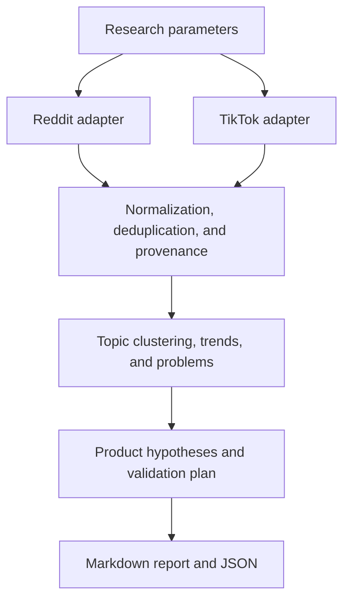

<h1 align="left">
  NicheHunter<br>
  <sub>From Reddit and TikTok observations to testable ideas for small digital products.</sub>
</h1>

<p align="center">
  
</p>

NicheHunter is a planned research tool for finding promising niches before development begins. It is designed as a repeatable workflow: collect signals from selected sources, identify growing topics and unmet needs, compare them with existing solutions, and propose product hypotheses together with a way to reach the audience.

> **Status as of October 29, 2026:** preparing the first iteration. The repository contains a project description, working instructions, and an avatar. Data collectors, analytics, and run commands have not been implemented yet. The sections below describe the intended behavior; this README will be updated as implementation progresses and sources are verified.

## Why this project exists

A small app can be built quickly, but several questions need answers first:

- Who has a specific problem, and how often does it occur?
- Which solutions do people already use, and what are they unhappy with?
- Is there sustained demand or a brief spike in attention?
- Which channel can bring the product to this audience?
- Is there evidence of willingness to pay, and what still needs to be tested?
- What minimal experiment should come before full development?

NicheHunter should shorten the path from scattered discussions and trends to a small set of well-supported hypotheses. The main focus is narrowly scoped digital products that can be built and tested quickly: iOS apps, web tools, and small services.

## Core idea: Distribution First

Product selection starts with an audience and a channel through which it can be reached:

```text
Channel and audience
  → observed problem or desire
  → validation of demand and existing solutions
  → product and economic hypothesis
  → minimal experiment
  → MVP and measurement of actual user behavior
```

The research considers two acquisition models:

| Model | How interest in the product arises | What matters for the hypothesis |
| --- | --- | --- |
| Existing demand | Someone is already looking for a solution to a specific task | Problem wording, intent to solve it, alternatives in use |
| Discovery through content | Someone notices a useful or appealing result in their feed | A clear demonstration, understandable value, a reason to visit the product |

An idea should therefore include both the product itself and its proposed distribution method. For example, a suitable experiment for one task might involve finding people who are already asking for a solution, while another might call for a short demonstration of the result on TikTok.

## First iteration: Reddit + TikTok

The first iteration targets **both sources**. Adapters will be added in stages after actual data access has been verified. Each source must work independently; combined research should show overlaps, differences, and gaps in the observations.

### Reddit: problems, workarounds, and unmet demand

The plan is to collect relevant posts and available comments by topic, query, and selected community. Observations need links, identifiers, dates, and available activity metrics.

What to look for:

- Recurring questions such as “how do I do this,” “is there an app,” and “what alternatives are there.”
- Manual tasks and awkward workarounds that people repeat regularly.
- Complaints about the price, complexity, quality, or limitations of existing products.
- Descriptions of a specific audience, task, and usage context.
- Direct statements about purchases or willingness to pay, where such evidence exists.

The output should be verifiable problem statements with links to discussions. Analysis must account for duplicates, promotional posts, community characteristics, and sample size. One popular thread alone does not establish sustained market demand.

### TikTok: topics, search signals, and product demonstrations

The plan is to research available topics and content: search recommendations, topic groups, hashtags, videos, product demonstrations, and comments. The specific dataset will depend on the verified source, region, and permissions.

What to look for:

- Recurring demonstrations of useful results: “before/after,” automation, or a quick solution to a task.
- Viewer questions about which tool produced a result and how to reproduce it.
- Topics that sustain interest across different creators and multiple time periods.
- Search needs and gaps in suitable content where the source actually provides such data.
- Creative approaches that can be used in a small test of a product hypothesis.

Search queries, recommended keywords, topic groups, hashtags, and views will be treated as different signal types. Information about an exact search phrase must not be automatically replaced with a topic name, nor video views with search counts.

TikTok data access options, including Business Discovery, Creator Search Insights, Creative Center, and third-party providers, must be verified before an integration is selected. A trends interface does not guarantee an available API or historical search volumes. If only content signals are available, the report must state this explicitly.

### Combined analysis

Reddit and TikTok should complement each other. For example, discussions may reveal a recurring manual task, while videos may show how clearly and visually its solution can be demonstrated.

Overlapping topics will warrant deeper investigation. However, reposts, retellings of the same material, and related promotional posts must not be counted as independent corroboration. The absence of a signal in the second source will also be reflected in the report.

## How the research will work

1. **Define the scope.** Select sources, topics, languages, region, date range, time zone, and collection limits.
2. **Check availability.** Determine which fields and periods are actually available and whether authorization or manual import is required.
3. **Collect observations.** Paginate through available results, preserving provenance and permitted data snapshots.
4. **Clean and group.** Remove duplicates, flag spam, and group similar wording while preserving original texts and links.
5. **Assess trends.** Compare comparable periods, baseline size, source diversity, and topic persistence where the data allow it.
6. **Extract problems.** Describe the audience, task, alternatives in use, and shortcomings of current solutions.
7. **Generate opportunities.** Propose 3–5 narrowly scoped product hypotheses with an acquisition channel, monetization, and a minimal MVP.
8. **Prepare validation.** Propose an experiment for each hypothesis and define in advance which result would support or refute it.

Competitor, pricing, and commercial demand validation will be a separate part of the evidence supporting each hypothesis. Until additional sources are connected, these questions will remain explicitly listed as items for further research.

### Example future request

> Research Reddit and TikTok over the last seven complete days on the topic of productivity. Look for recurring tasks, awkward workarounds, and demonstrations of useful tools. Compare with the previous seven days where history is available. Prepare five hypotheses for small products, with links, limitations, and a validation plan.

This is an example of the intended scenario, not a command that can already be executed.

### Research parameters

| Parameter | Purpose |
| --- | --- |
| Sources | Reddit, TikTok, or combined analysis |
| Topics and filters | Queries, categories, subreddits, hashtags — depending on the source |
| Period and time zone | Explicit boundaries of the analysis window; the default reference is seven complete local days |
| Comparison period | A preceding comparable, non-overlapping interval of the same duration |
| Language and region | Filters limited to actually available data; unconfirmed geography is noted separately |
| Limits | Maximum records, sampling limitations, and minimum evidence count |
| Output format | Markdown report and structured JSON; CSV when needed |

The requested period will be shown separately from actual coverage. If a source returns only a current selection, limited history, or a rolling aggregate, this limitation must be visible in the output.

## What the user should receive

### Report: `report.md`

The report is planned to include:

- Research parameters, collection time, actual coverage, and source limitations.
- Key observations and topics classified as emerging, sustained, declining, or an isolated spike.
- Metrics and a comparison baseline where available and comparable.
- User problems, audiences, existing solutions, and identified gaps.
- Links to primary sources for material conclusions.
- A shortlist of product opportunities and next steps for validation.
- Missing data and questions the research cannot yet answer.

### Product hypothesis card

| Field | Content |
| --- | --- |
| Audience and task | Who wants to do what, and in which situation |
| Observed problem | What gets in the way and which evidence supports it |
| Alternatives | Which tools or manual processes are already in use |
| Product idea | A narrow use case and a clear value proposition |
| Minimal MVP | What is sufficient to implement to test the key assumption |
| Distribution | Proposed channel and an example message or demonstration |
| Monetization | A payment model hypothesis and grounds for testing it |
| Experiment | An interview, demonstration, landing page, prototype, or another suitable test |
| Decision criteria | Which measurable result allows validation to continue, change, or stop |
| Confidence and gaps | Strength of evidence, risks, and unknown values |

### Data: `results.json`

Structured output is needed for repeat analysis and future integrations. It should contain run parameters, observations and links to them, calculated metrics, trends, problems, hypotheses, errors, and data gaps.

Permitted raw snapshots and derived conclusions will be stored separately. This will make it possible to trace the origin of a conclusion and repeat calculations on the same set of observations. The exact schema and file locations will be defined during implementation.

## Analysis principles

**Conclusions must be verifiable.** Factual observations, estimates, interpretations, and product hypotheses will be labeled separately. Numbers require a source, unit of measurement, time window, and methodology.

**Unknowns remain unknown.** Missing metrics will be represented as `null` or `unknown` with an explanation. An unavailable source, authorization error, sampling limitation, or lack of history must not turn into fabricated data.

**Attention and commercial demand are assessed separately.** Views and comments show reactions to content. Willingness to pay, actual conversion, CAC, LTV, and return on investment require additional evidence and experiments.

**Trends require comparable data.** A counter retrieved later for an old video does not show its past value. Overlapping seven-day windows cannot be added together into a monthly volume, and a large growth percentage from a baseline of one requires careful interpretation.

**Hypothesis priority must be explainable.** Selection will consider evidence of the problem, audience accessibility, proposed monetization, shortcomings of alternatives, and MVP complexity. Priority score, confidence, and evidence count will be stored separately; missing data will not be treated as an average result.

**Data access must be sustainable and permitted.** Current APIs, access rights, limits, and storage terms must be verified for each source. If programmatic access is unavailable, explicitly labeled manual import may be used. Secrets must not enter the repository or logs.

## Proposed architecture

The diagram below shows the future pipeline; the corresponding modules have not been implemented yet.



Each adapter will describe its own capabilities and limitations. Shared analytics should work with normalized observations while preserving the meaning of the original metrics. This will allow new sources to be added without collapsing different signal types into a single popularity metric.

The technology stack, runtime, and execution interface have not been selected yet. The target format is a reusable research workflow that can be packaged as a skill with collection and analysis tools. Decisions about CLI, MCP, and other execution methods will follow integration requirements.

## First-iteration plan

- [x] Document the project concept and core data reliability requirements.
- [x] Prepare the README, avatar, and repository working instructions.
- [ ] Verify available Reddit and TikTok sources, their schemas, permissions, and historical coverage.
- [ ] Select a runtime, execution method, and normalized observation schema.
- [ ] Implement collection and processing for one source, then connect the second.
- [ ] Add deduplication, date handling, and period comparisons where justified.
- [ ] Prepare a combined problem analysis and 3–5 product hypotheses with evidence.
- [ ] Generate a Markdown report and JSON with explicit gaps and limitations.
- [ ] Verify behavior using fixtures and real data, clearly distinguishing the results of each type of verification.

The first iteration is complete when research can be conducted across both sources, material conclusions can be traced to original observations, and a clear hypothesis validation plan can be produced. If one source is unavailable or covers only part of the period, the research must finish with an explicit description of that limitation.

Checks must cover date boundaries, deduplication, small and zero comparison baselines, overlapping windows, unavailable fields, and partial collection. Demonstration data will be clearly separated from observations actually retrieved.

## Future development

After the first iteration, demand cross-validation can be expanded through search sources, App Store intelligence, competitor reviews and pricing, and ad libraries. Further directions include accumulating a permitted history of observations, analyzing topic persistence, and comparing hypotheses with real experiment results.

Regular collection, additional integrations, and automation will be separate stages after the sources and core workflow have been verified.

## Repository and getting started

Current structure:

```text
.
├── AGENTS.md      # Context and rules for future work
├── README.md      # Project concept and first-iteration plan
├── avatar.png     # Project avatar
├── context.md     # Original project design context
├── LICENSE        # MIT
└── .gitignore
```

The working branch is `develop`. There are no installation, run, or test commands yet. They will be added here along with the implementation.

Project working instructions: [AGENTS.md](./AGENTS.md).

Original project design context: [context.md](./context.md).

## License

[MIT](./LICENSE).
