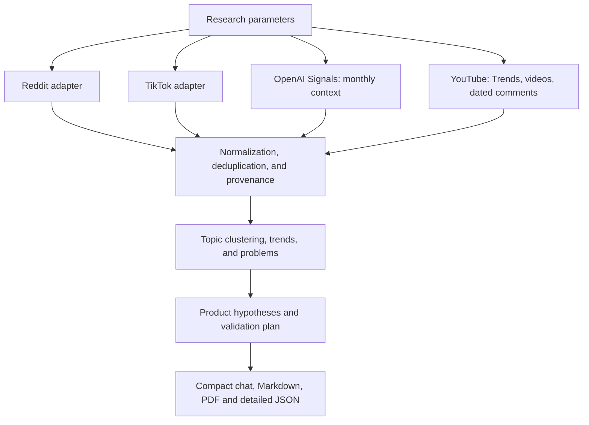

<h1 align="left">
  Niche Hunter<br>
  <sub>From Reddit and TikTok observations to testable ideas for small digital products.</sub>
</h1>

<p align="center">
  
</p>

Niche Hunter is a research skill for discovering niches for new digital products and refining existing products. Its decision chain is **distribution channel → reachable market and need → product or product change → validation experiment**. It collects available signals, analyzes needs and alternatives, and explains which combinations deserve testing and where evidence is still missing.

> **Release 0.8.0 · November 11, 2026.** Reports add next steps for each provider and an overall comparison when multiple providers are selected. OpenAI Signals tables show changes from the previous month in percentage points.

[Install for Codex](#install-for-codex) · [Install for Claude Code](#install-for-claude-code) · [API-key setup](#api-key-setup) · [Update](#update) · [Rollback](#rollback) · [Releases](https://github.com/roland19deschain/niche-hunter/releases) · [Changelog](./CHANGELOG.md)

**YouTube since 0.5.0:** the `youtube` provider combines Google Trends **YouTube Search Top/Rising → relevant videos → comments published in the requested period → current-like ranking within that sample**. It produces a separate YouTube table and conclusion in chat, Markdown and PDF. The owner reports one successful authenticated Desktop run in the Code tab on November 10. Chat-tab invocation, confirmed quota and broader sampling remain pilot checks. [Setup, automatic/CSV routes and limits](./skills/niche-hunter/references/youtube.md).

TikTok v1 covers search topics, topic detail/related topics and autocomplete. Seven-day popularity remains a supplier claim, with unknown source dates preserved; it does not provide verified exact query counts or arbitrary historical windows. Signals supplies broad monthly context, not weekly search logs.

### TikTok connection setup

Ask: **"Use Niche Hunter to set up TikTok."** Reuse a working connection, choose an owner-supplied API key, or sign in to your own TokConnect account through the browser. A key recipient does not need to register with TokConnect or use the owner's login. Passwords and tokens do not ship with the skill and must not be pasted into a chat. The API-key workflow below is included in 0.4.0 and later; older installations need an update.

A bare skill invocation also checks all selected providers before research. If access is missing, it presents the supported setup choices without needing a separate setup prompt: TokConnect browser sign-in or an owner-supplied API key where the client supports it. It waits for the selection, reuses configured providers and continues the original research request once ready. Reddit currently needs an existing supported connection/export; public Signals requires no login. The YouTube route asks for a YouTube API key plus either a SerpApi key with confirmed free allowance or a native Trends related-query CSV. Existing fresh imports can be reused. Explicitly excluded providers are not configured.

#### API-key setup

Receive the TokConnect key privately from its owner, install the skill, and ask: **"Set up TikTok with an API key supplied by its owner."** The skill directs you to enter it outside the conversation. From a checkout or extracted runtime package, choose one command and run it yourself in a terminal:

```bash
python3 skills/niche-hunter/scripts/setup_access.py --client codex
```

or:

```bash
python3 skills/niche-hunter/scripts/setup_access.py --client claude-code
```

For an installed plugin, the skill supplies its actual script path. Codex setup requires Python **3.11+**; Claude Code setup and research require Python 3.10+. Close the target client before setup. Paste the key once into the hidden prompt, then restart the client. Setup saves `niche-hunter-tokconnect` in private user settings, preserves unrelated settings and makes no network or research calls. The file holds the key as plaintext with owner-only POSIX permissions; it is not an encrypted vault. Later runs reuse the connection. Append `--replace` to rotate its key or `--remove` to remove this connection. These settings live outside the plugin and survive normal package updates.

In **Claude.app**, where **Request headers** is available, add the custom TokConnect connector URL `https://mcp.tokconnect.com/mcp`, choose **No sign-in**, and enter `Authorization` with value `Bearer ` followed by the key directly in that credential field. Request headers is a limited beta. This native connector is separate from Claude Code configuration. The command above configures Codex, not ordinary ChatGPT Chat; that surface currently needs a supported OAuth connection or import. [Client-specific setup, rotation and limitations](./skills/niche-hunter/references/access.md).

Before research, confirm supported tools and the current shared free-credit allowance through a non-research facility or a nonsecret confirmation from the owner. Saving a key does not verify account access or grant paid-spending permission. If an unauthenticated bundled duplicate remains, disable only that duplicate in MCP settings and keep the research skill enabled. No account password or browser session is needed for the API-key route.

#### Browser sign-in alternative

For a first run in Claude Code, update/install the plugin, open `/mcp`, select its bundled TokConnect server and sign in with your existing account. Then invoke:

```text
/niche-hunter:niche-hunter set up TikTok using my existing TokConnect account
```

Setup checks every selected provider before research, reuses working connections and asks for missing configuration. Public Signals needs no credentials. TikTok processing does not require a terms-of-use link or storage declaration. Once ready, request a small run:

```text
/niche-hunter:niche-hunter research product opportunities using only TikTok for the last 7 days
```

Niche Hunter writes a short `report.md`, a styled `report.pdf` and detailed `results.json` in your working project. Each provider has a table, a brief conclusion and any useful next steps. Runs with multiple providers add an overall comparison; the report shows only supported channel/problem/product ideas. The PDF uses a dark background on every page. Native charts/artifacts use matching colors when supported; the skill does not change the application's chat background. Detail is available on request. PDF export uses the optional `requirements-pdf.txt` dependency or the client's native PDF exporter; see [reporting](./skills/niche-hunter/references/reporting.md). A 14-day request cannot extend an unavailable source window: the report discloses actual coverage. Authorize TokConnect in the client you will use; installation and another client's login do not establish this connection.

**Known OAuth issue (November 5):** a Claude Code 2.1.316 login attempt failed before browser consent with `client_uri: Invalid URL`. An owner-supplied key is a separate supported setup route in 0.4.0 and later; it does not establish that OAuth is repaired. Verify the key owner's allowance rather than asking a recipient to create an account. Do not change billing, patch the client or bypass OAuth validation to continue.

The first adapter covers search topics, topic detail/related topics, and autocomplete. It does not yet normalize videos, comments, ads, or Shop sales. Read [the TikTok setup and capture reference](./skills/niche-hunter/references/tiktok.md) for supported methods and honest coverage fallbacks. Standalone skill copies need a separately configured MCP connection. See [Privacy](./PRIVACY.md) for data handling.

### YouTube setup

Ask: **"Use Niche Hunter with only YouTube for the last 7 days."** The skill checks configuration before research. For automatic collection, enable YouTube Data API v3 in your Google Cloud project and obtain its key, plus an optional SerpApi key for Google Trends. SerpApi advertises 250 free searches/month; verify the actual remaining allowance. Alternatively provide a native Google Trends **YouTube Search related-queries CSV** and use only the Google key. The skill does not create accounts or buy subscriptions.

Run personally in your terminal; never paste keys in chat:

```bash
python3 skills/niche-hunter/scripts/youtube.py setup
# Or, for Trends CSV imports:
# python3 skills/niche-hunter/scripts/youtube.py setup --csv-only
python3 skills/niche-hunter/scripts/youtube.py status
```

Keys stay in private local settings outside Git/plugin files. Saving them makes no network calls and does not prove authentication or quotas. The calling agent allocates the shared ten-call budget, invokes the collector, imports evidence and finalizes the report. Trends indices are relative; likes are current snapshots. The result is not a platform-wide search census or a global comment ranking. Source-specific retention and intended analytics require separate live acceptance; see [the full YouTube reference](./skills/niche-hunter/references/youtube.md).

## Claude Desktop pilot

On an Apple silicon Mac, download both Desktop assets from the [0.8.0 release](https://github.com/roland19deschain/niche-hunter/releases/tag/0.8.0). Install the `.mcpb` extension and upload `niche-hunter-skill-0.8.0.zip` in Claude Desktop. Set provider keys and authorized per-run limits in the extension settings. The pilot uses the Mac for collection and report export and needs no terminal setup. See the [Claude Desktop installation and workflow](./skills/niche-hunter/references/claude-desktop.md).

## Install for Codex

Use a Codex client with `plugin add` and `plugin marketplace` support (`codex plugin --help`). Register the stable source, then install:

```bash
codex plugin marketplace add roland19deschain/niche-hunter --ref master
codex plugin add niche-hunter@niche-hunter
codex plugin list --marketplace niche-hunter
```

Start a new chat in your working project and request:

```text
$niche-hunter:niche-hunter research product opportunities for the last 7 days
```

In supported desktop clients the configured marketplace is also available in the plugin browser. This is GitHub marketplace distribution, not a listing in the official public plugin directory. See [OpenAI's plugin guide](https://developers.openai.com/plugins/build/plugins#add-a-marketplace-from-the-cli). If your client lacks these commands, use the [manual alternative](#manual-alternative).

## Install for Claude Code

Run in your terminal with a current Claude Code version:

```bash
claude plugin marketplace add roland19deschain/niche-hunter#master
claude plugin install niche-hunter@niche-hunter
claude plugin list
```

Or, inside Claude Code, use `/plugin install niche-hunter --marketplace roland19deschain/niche-hunter#master` and choose the installation scope in the plugin panel. Invoke the installed plugin skill as:

```text
/niche-hunter:niche-hunter research product opportunities for the last 7 days
```

Plugin skills have a namespace; `/niche-hunter` is the repository-local skill, while `/niche-hunter:niche-hunter` belongs to the installed plugin. See [Claude Code plugin installation](https://code.claude.com/docs/en/discover-plugins).

## Update

Stable installations follow `master`. We publish tested changes as numbered releases with a changelog; `develop` is for ongoing work. Installing a tag instead of `master` pins that version and does not track later releases.

Codex:

```bash
codex plugin marketplace upgrade niche-hunter
codex plugin add niche-hunter@niche-hunter
codex plugin list --marketplace niche-hunter
```

Claude Code:

```bash
claude plugin marketplace update niche-hunter
claude plugin update niche-hunter@niche-hunter
claude plugin list
```

Start a new chat after an update. Claude Code also supports `/reload-plugins`. For background updates there, open `/plugin` → Marketplaces → Niche Hunter → Enable auto-update; third-party marketplaces default to off. Codex's explicit refresh commands above are the supported documented path here; automatic update behavior across clients is not guaranteed. [Claude Code update behavior](https://code.claude.com/docs/en/discover-plugins#keep-plugins-updated).

Keep reports and imports in your working project, outside the installed plugin directory. Client-managed provider credentials are separate from plugin files; updating the plugin does not require copying them into the repository.

## Rollback

Choose a tag from [GitHub Releases](https://github.com/roland19deschain/niche-hunter/releases). The commands below pin the earlier `0.1.0`; replace it with the desired published version. Removing this marketplace removes its plugin registration/cache and may clear plugin-managed settings/data, so keep research output outside those directories and retain any configuration you need to reapply. Version 0.1.0 contains no MCP server; 0.2.0 adds a TokConnect connection declaration. Neither version bundles provider credentials.

Codex:

```bash
codex plugin remove niche-hunter@niche-hunter
codex plugin marketplace remove niche-hunter
codex plugin marketplace add roland19deschain/niche-hunter --ref 0.1.0
codex plugin add niche-hunter@niche-hunter
```

Claude Code:

```bash
claude plugin uninstall niche-hunter@niche-hunter
claude plugin marketplace remove niche-hunter
claude plugin marketplace add roland19deschain/niche-hunter#0.1.0
claude plugin install niche-hunter@niche-hunter
```

Start a new chat and verify the installed version with the client's plugin list. To resume stable updates, repeat the remove/add/install steps with `master` instead of the tag. Do not edit versioned plugin cache files directly.

### Manual alternative

For clients without plugin management, clone this repository, check out a published tag, and follow the client's standalone-skill installation instructions for `skills/niche-hunter/`. Codex scans `~/.agents/skills/`; Claude Code scans `~/.claude/skills/`. Both support symlinked skill directories. A copy is a fixed snapshot and must be replaced on update; a link to your clone changes when you check out another version. Use `$niche-hunter` / `/niche-hunter` for standalone installation. Avoid keeping both the standalone and plugin copies enabled.

Release ZIPs include the plugin manifests, shared runtime, README, avatar, license and changelog. They exclude repository working instructions, research runs, credentials, tests, and build tools. Contributor documentation links in the packaged README point to the corresponding source tag. `SHA256SUMS` accompanies each ZIP. [Release procedure and verification](./docs/releasing.md).

## Why this project exists

A small app can be built quickly, but several questions need answers first:

- Who has a specific problem, and how often does it occur?
- Which solutions do people already use, and what are they unhappy with?
- Is there sustained demand or a brief spike in attention?
- Which channel can bring the product to this audience?
- Is there evidence of willingness to pay, and what still needs to be tested?
- What minimal experiment should come before full development?

NicheHunter should shorten the path from scattered discussions and trends to a small set of well-supported hypotheses. The main focus is narrowly scoped digital products that can be built and tested quickly: iOS apps, web tools, and small services.

## Core idea: Distribution First

Product selection starts with an audience and a channel through which it can be reached:

```text
Channel and audience
  → observed problem or desire
  → validation of demand and existing solutions
  → product and economic hypothesis
  → minimal experiment
  → MVP and measurement of actual user behavior
```

The research considers two acquisition models:

| Model | How interest in the product arises | What matters for the hypothesis |
| --- | --- | --- |
| Existing demand | Someone is already looking for a solution to a specific task | Problem wording, intent to solve it, alternatives in use |
| Discovery through content | Someone notices a useful or appealing result in their feed | A clear demonstration, understandable value, a reason to visit the product |

An idea should therefore include a concrete entry point, audience/intent, proposed product, and path to first useful outcome. Evidence for a problem and evidence for a channel are assessed separately: a Reddit complaint does not establish search demand, and aggregate ChatGPT usage does not establish an acquisition route. Channel fit remains supported, inferred, or untested; none of these labels establishes profitable acquisition.

Use discovery mode for new products. When asking about an existing product, provide its purpose and relevant constraints; refinement mode evaluates positioning, workflow, features, or acquisition changes relative to that product. Both modes can return no hypotheses when available evidence is insufficient. A useful recurring need does not have to be a growing trend.

## Providers: Reddit + TikTok + ChatGPT + YouTube

Version 0.5.0 registers **four providers**. The caller can select one or several; unavailable sources remain visible in the coverage table. Reddit/TikTok collection uses permitted tools connected to the calling agent or a normalized import. The Python helper automatically collects the public ChatGPT aggregate source.

### Reddit: problems, workarounds, and unmet demand

The plan is to collect relevant posts and available comments by topic, query, and selected community. Observations need links, identifiers, dates, and available activity metrics.

What to look for:

- Recurring questions such as “how do I do this,” “is there an app,” and “what alternatives are there.”
- Manual tasks and awkward workarounds that people repeat regularly.
- Complaints about the price, complexity, quality, or limitations of existing products.
- Descriptions of a specific audience, task, and usage context.
- Direct statements about purchases or willingness to pay, where such evidence exists.

The output should be verifiable problem statements with links to discussions. Analysis must account for duplicates, promotional posts, community characteristics, and sample size. One popular thread alone does not establish sustained market demand.

### TikTok: topics, search signals, and product demonstrations

The plan is to research available topics and content: search recommendations, topic groups, hashtags, videos, product demonstrations, and comments. The specific dataset will depend on the verified source, region, and permissions.

What to look for:

- Recurring demonstrations of useful results: “before/after,” automation, or a quick solution to a task.
- Viewer questions about which tool produced a result and how to reproduce it.
- Topics that sustain interest across different creators and multiple time periods.
- Search needs and gaps in suitable content where the source actually provides such data.
- Creative approaches that can be used in a small test of a product hypothesis.

Search queries, recommended keywords, topic groups, hashtags, and views will be treated as different signal types. Information about an exact search phrase must not be automatically replaced with a topic name, nor video views with search counts.

TikTok data access options, including Business Discovery, Creator Search Insights, Creative Center, and third-party providers, must be verified before an integration is selected. A trends interface does not guarantee an available API or historical search volumes. If only content signals are available, the report must state this explicitly.

### ChatGPT: public OpenAI Signals

The helper downloads the public release and reads monthly global message shares by broad topic. It retains the source ZIP, hash, attribution, actual month, and a comparable preceding month where available. This is aggregate context: no private conversations, original prompts, weekly query volumes, or narrow-topic demand are exposed. For a weekly request, monthly data is labeled separately; unsupported narrow topics produce an explicit status.

Source and license: [OpenAI Signals, CC BY 4.0](https://openai.com/signals/data-download/). Monthly share changes do not prove absolute usage growth or willingness to pay.

### YouTube: search-interest changes and current questions

The YouTube adapter combines Google Trends **YouTube Search Top/Rising** with relevant videos and comments originally published in the selected interval. It can discover fresh comments on older videos and keeps query → video → comment links. Current likes order only the fetched sample; source-relative indices and growth labels retain their scope. The caller chooses automatic SerpApi delivery or a native Trends CSV; Google Data API supplies public videos/comments. No absolute searches, historical likes or global maximum is claimed. Live authentication, quotas and intended analytics acceptance remain pending. [Portable reference](./skills/niche-hunter/references/youtube.md).

### Combined analysis

Reddit and TikTok should complement each other. For example, discussions may reveal a recurring manual task, while videos may show how clearly and visually its solution can be demonstrated.

Overlapping topics will warrant deeper investigation. However, reposts, retellings of the same material, and related promotional posts must not be counted as independent corroboration. The absence of a signal in the second source will also be reflected in the report.

## How the research will work

1. **Define the scope.** Select sources, topics, languages, region, date range, time zone, and collection limits.
2. **Check availability.** Determine which fields and periods are actually available and whether authorization or manual import is required.
3. **Collect observations.** Paginate through available results, preserving provenance and permitted data snapshots.
4. **Clean and group.** Remove duplicates, flag spam, and group similar wording while preserving original texts and links.
5. **Assess trends.** Compare comparable periods, baseline size, source diversity, and topic persistence where the data allow it.
6. **Extract problems.** Describe the audience, task, alternatives in use, and shortcomings of current solutions.
7. **Construct opportunities.** When evidence supports them, display at most three brief channel → problem/need → product combinations, or changes to an existing product. Keep detailed route-to-value, alternatives, monetization assumptions and MVP reasoning in JSON for requested follow-up. Fewer or none is valid.
8. **Challenge and prioritize.** Include counterevidence and identify the weakest link. Recommend testing next, researching more, or deferring, with a reason and a measurable experiment that could refute the hypothesis.

Competitor, pricing, and commercial demand validation will be a separate part of the evidence supporting each hypothesis. Until additional sources are connected, these questions will remain explicitly listed as items for further research.

### Example future request

> Research Reddit and TikTok over the last seven complete days on the topic of productivity. Look for recurring tasks, awkward workarounds, and demonstrations of useful tools. Compare with the previous seven days where history is available. Prepare five hypotheses for small products, with links, limitations, and a validation plan.

This scenario can now be requested through the skill. Its usefulness depends on permitted connected evidence; the skill will return fewer hypotheses or none when support is insufficient.

### Research parameters

| Parameter | Purpose |
| --- | --- |
| Sources | Selected subset of Reddit, TikTok, ChatGPT and YouTube |
| Decision and product context | New-product discovery, or refinement of a caller-described existing product |
| Distribution constraints | Optional caller-selected channels; otherwise propose routes and label their evidence status |
| Topics and filters | Queries, categories, subreddits, hashtags — depending on the source |
| Period and time zone | Explicit boundaries of the analysis window; the default reference is seven complete local days |
| Comparison period | A preceding comparable, non-overlapping interval of the same duration |
| Language and region | Filters limited to actually available data; unconfirmed geography is noted separately |
| Limits | Maximum records, sampling limitations, and minimum evidence count |
| Output format | Compact chat/terminal presentation, matching Markdown/PDF and detailed JSON |

The requested period will be shown separately from actual coverage. If a source returns only a current selection, limited history, or a rolling aggregate, this limitation must be visible in the output.

## What the user should receive

### Report: `report.md`

The skill's report includes the available parts of:

- Research parameters, collection time, actual coverage, and source limitations.
- Key observations and topics classified as emerging, sustained, declining, or an isolated spike.
- Metrics and a comparison baseline where available and comparable.
- User problems, audiences, existing solutions, and identified gaps.
- Links to primary sources for material conclusions.
- A channel → market/need → product shortlist, prioritized next actions, and tests of the weakest links.
- Missing data and questions the research cannot yet answer.

### Detailed assessment retained in JSON

| Field | Content |
| --- | --- |
| Audience and task | Who wants to do what, and in which situation |
| Observed problem | What gets in the way and which evidence supports it |
| Alternatives | Which tools or manual processes are already in use |
| Product idea | A narrow use case and a clear value proposition |
| Minimal MVP | What is sufficient to implement to test the key assumption |
| Market and distribution | Reachable segment/intent, channel entry point, message/demo, and path to first value |
| Evidence for the combination | Separate need and channel evidence; supported/inferred/untested fit and counterevidence |
| Existing-product change | In refinement mode, what changes relative to the caller's current product and why |
| Monetization | A payment model hypothesis and grounds for testing it |
| Experiment | An interview, demonstration, landing page, prototype, or another suitable test |
| Decision criteria | Which measurable result allows validation to continue, change, or stop |
| Confidence and gaps | Strength of evidence, risks, and unknown values |
| Next action | Test next, research more, or defer, with a reason |

### Data: `results.json`

Structured output is needed for repeat analysis and future integrations. It should contain run parameters, observations and links to them, calculated metrics, trends, problems, hypotheses, errors, and data gaps.

The versioned v0.1 contract separates normalized observations from calling-agent conclusions. A permitted public Signals snapshot is stored under the run's `raw/`; imported third-party originals are not copied automatically. See [runtime contracts](./skills/niche-hunter/references/contracts.md) for import, analysis, and replay details.

## Analysis principles

**Conclusions must be verifiable.** Factual observations, estimates, interpretations, and product hypotheses will be labeled separately. Numbers require a source, unit of measurement, time window, and methodology.

**Unknowns remain unknown.** Missing metrics will be represented as `null` or `unknown` with an explanation. An unavailable source, authorization error, sampling limitation, or lack of history must not turn into fabricated data.

**Attention and commercial demand are assessed separately.** Views and comments show reactions to content. Willingness to pay, actual conversion, CAC, LTV, and return on investment require additional evidence and experiments.

**Trends require comparable data.** A counter retrieved later for an old video does not show its past value. Overlapping seven-day windows cannot be added together into a monthly volume, and a large growth percentage from a baseline of one requires careful interpretation.

**Hypothesis priority must be explainable.** Selection will consider evidence of the problem, audience accessibility, proposed monetization, shortcomings of alternatives, and MVP complexity. Priority score, confidence, and evidence count will be stored separately; missing data will not be treated as an average result.

**Data access must be sustainable and permitted.** Current APIs, access rights, limits, and storage terms must be verified for each source. If programmatic access is unavailable, explicitly labeled manual import may be used. Secrets must not enter the repository or logs.

## Proposed architecture

The skill coordinates collection and analysis. The helper performs deterministic normalization and reporting; semantic analysis runs in the calling agent.



Each adapter will describe its own capabilities and limitations. Shared analytics should work with normalized observations while preserving the meaning of the original metrics. This will allow new sources to be added without collapsing different signal types into a single popularity metric.

The portable helper uses Python 3.10+ and its standard library. Connected MCP tools remain client-specific; the common skill has no dependency on one model supplier's SDK. There is no hosted backend or background collector.

## First-iteration plan

- [x] Document the project concept and core data reliability requirements.
- [x] Prepare the README, avatar, and repository working instructions.
- [ ] Validate authenticated Reddit/TikTok access, schemas, permissions, quotas, and historical coverage.
- [x] Select a runtime, shared skill format, and versioned normalized observation contract.
- [x] Implement public Signals collection and permitted import processing.
- [x] Implement the YouTube Trends/video/dated-comment route with synthetic tests; authenticated acceptance remains pending.
- [x] Add source-ID deduplication, calendar date handling, and supported monthly share comparisons.
- [ ] Evaluate a compact cross-provider analysis and up to three product combinations supported by evidence.
- [x] Generate a Markdown report and JSON with explicit gaps and limitations.
- [x] Verify helper behavior using synthetic fixtures and the public Signals release, separately labeled.
- [ ] Verify fresh-session discovery and representative model behavior in both Codex and Claude Code.

The skill configures every selected provider before research; the caller can explicitly select one accessible source or exclude missing ones. Failures after configuration produce honest partial coverage. Full integration readiness still requires suitable Reddit/TikTok access and evidence-backed product research. Material conclusions must trace to observations, with a clear hypothesis validation plan.

Checks must cover date boundaries, deduplication, small and zero comparison baselines, overlapping windows, unavailable fields, and partial collection. Demonstration data will be clearly separated from observations actually retrieved.

## Future development

After the first iteration, demand cross-validation can be expanded through search sources, App Store intelligence, competitor reviews and pricing, and ad libraries. Further directions include accumulating a permitted history of observations, analyzing topic persistence, and comparing hypotheses with real experiment results.

Regular collection, additional integrations, and automation will be separate stages after the sources and core workflow have been verified.

## Repository and getting started

Current structure:

```text
.
├── AGENTS.md      # Context and rules for future work
├── README.md      # Project concept and first-iteration plan
├── avatar.png     # Project avatar
├── docs/
│   └── development-plan.md  # Canonical context, access findings, roadmap, and handoff
├── docs/releasing.md       # Maintainer release and rollback procedure
├── plugin.json            # Portable plugin identity and release version
├── .claude-plugin/        # Claude manifest and GitHub marketplace
├── .agents/plugins/       # Codex GitHub marketplace
├── .github/workflows/     # CI and tag-triggered GitHub Releases
├── scripts/release.py     # Version checks, reproducible ZIP, checksums and notes
├── CHANGELOG.md
├── skills/niche-hunter/    # Shared SKILL.md, Python helper, references, UI metadata
├── .agents/skills/niche-hunter -> ../../skills/niche-hunter
├── .claude/skills/niche-hunter -> ../../skills/niche-hunter
├── tests/test_research.py  # Synthetic behavioral checks
├── LICENSE        # MIT
└── .gitignore
```

The working branch is `develop`; `master` is the stable distribution source. Both project skill links point to one canonical directory. Project discovery locations and symlinks are documented by [OpenAI](https://learn.chatgpt.com/docs/build-skills#where-codex-loads-local-skills) and [Claude Code](https://code.claude.com/docs/en/skills#choose-where-skills-load). Repository-local invocation is useful for contributors; published plugin users should use the installation instructions above. Interactive research behavior is separate from packaging/CLI validation, and cloud surfaces may have different plugin-loading rules.

Examples in Codex:

```text
$niche-hunter
$niche-hunter only TikTok for 14 days, topic: horoscopes
$niche-hunter Reddit and ChatGPT for the last 7 days
```

Use `/niche-hunter` with the same request in Claude Code. The agent extracts parameters, checks available permitted connections, calls the helper and adds evidence-linked analysis. Default providers are all four (`reddit,tiktok,chatgpt,youtube`); default period is seven complete days in the caller's time zone. Unsupported sources/windows are disclosed. The bounded [resource catalog](./skills/niche-hunter/references/catalog.json) supplies discovery seeds, not observed demand.

Direct helper commands from the repository root (Python 3.10+ with IANA time-zone data):

```bash
# In the chosen environment, configure PDF export and verify the selected connections:
python3 -m pip install -r skills/niche-hunter/requirements-pdf.txt
python3 skills/niche-hunter/scripts/research.py preflight \
  --configured-providers reddit,tiktok,youtube

# After the calling client collects the configured external sources:
python3 skills/niche-hunter/scripts/research.py collect \
  --import-file REDDIT_IMPORT_JSON --import-file TIKTOK_IMPORT_JSON \
  --import-file YOUTUBE_IMPORT_JSON \
  --out .nichehunter/runs/first-run

# Only Reddit; no setup or requests for TikTok or Signals:
python3 skills/niche-hunter/scripts/research.py collect \
  --providers reddit --days 14 --import-file REDDIT_IMPORT_JSON \
  --out .nichehunter/runs/reddit-14d

# After the calling agent writes analysis.json using the evidence IDs:
python3 skills/niche-hunter/scripts/research.py finalize \
  --run .nichehunter/runs/first-run \
  --analysis .nichehunter/runs/first-run/analysis.json

python3 -m pip install pypdf  # development PDF extraction checks
python3 -m unittest discover -s tests -v
```

Choose a fresh output directory for every collection. Local `.nichehunter/` runs are ignored by Git. `collect` alone produces evidence and a report with analysis pending; `finalize` adds the agent's checked analysis without recollecting. For offline replay use `--offline --signals-file PATH`; for permitted Reddit/TikTok/YouTube data use `--import-file PATH` following the [contract](./skills/niche-hunter/references/contracts.md). This does not turn an unlicensed export into permitted data. Collection/normalization needs no external packages. Signals/import processing needs no API key; live YouTube collection requires the separate private configuration described above. PDF finalization uses ReportLab from `skills/niche-hunter/requirements-pdf.txt` or an equivalent PDF exported by the calling client. Before collection, complete preflight for every selected provider or explicitly exclude missing ones; use `--diagnostic` only for a requested maintenance check. Supply `--timezone` from the caller's chosen zone when available; otherwise the helper explicitly reports its UTC fallback. Region and language filters are optional and have no market-specific defaults.

Project working instructions: [AGENTS.md](./AGENTS.md).

Current scope, source-access findings, implementation contracts, and next steps: [development plan](./docs/development-plan.md). It is the canonical handoff for Reddit, TikTok, ChatGPT and YouTube.

## License

[MIT](./LICENSE).
